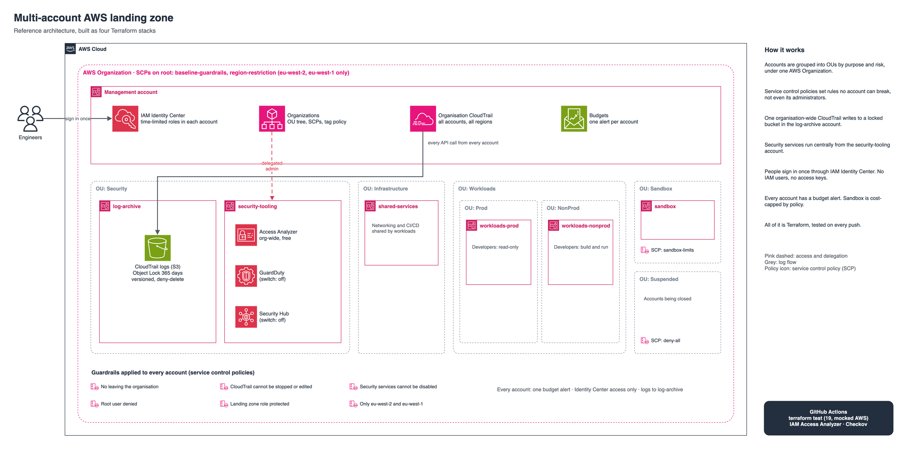

# Multi-account AWS landing zone in Terraform

[](https://github.com/gumagatsby/aws-landing-zone/actions/workflows/ci.yml)

The foundation an organisation builds before it runs anything serious on AWS: separate accounts for separate jobs, guardrails nobody can switch off, one tamper-evident audit trail, central security monitoring, and single sign-on instead of passwords and access keys. Everything is Terraform, split into four stacks that are tested on every push without touching a real AWS account.



Editable source: [`docs/architecture.drawio`](docs/architecture.drawio). Portrait version for social posts: [`docs/linkedin-architecture.drawio`](docs/linkedin-architecture.drawio).

## The problem it solves

Most companies start with one AWS account. Production, testing, experiments and billing all live together, everyone has broad access, and one mistake (a deleted log, a public bucket, a forgotten expensive instance) can affect everything. Auditors then ask who did what, and there is no reliable answer.

A landing zone fixes the structure before the workloads arrive:

| Need | How this landing zone meets it |
|---|---|
| Contain mistakes and breaches | Separate accounts per purpose; a problem in sandbox cannot reach production |
| Rules that cannot be bypassed | Service control policies apply to every account, including its administrators |
| Prove what happened | One organisation-wide CloudTrail, in an account most people cannot touch, with Object Lock and signed digests |
| Spot threats and misconfiguration | Access Analyzer across the organisation; GuardDuty and Security Hub ready to switch on |
| No shared passwords or keys | IAM Identity Center: people sign in once and get time-limited roles per account |
| Control spend | A budget alert per account, and SCPs that block expensive services in sandbox |

## Structure

```
Root
├── Security          log-archive · security-tooling
├── Infrastructure    shared-services
├── Workloads
│   ├── Prod          workloads-prod
│   └── NonProd       workloads-nonprod
├── Sandbox           sandbox (cost-capped)
└── Suspended         accounts being closed (everything denied)
```

## Guardrails (service control policies)

| Policy | Attached to | What it stops |
|---|---|---|
| `baseline-guardrails` | Whole organisation | Leaving the organisation; stopping or editing CloudTrail; disabling GuardDuty, Security Hub, Access Analyzer or Config; any action by an account's root user; tampering with the landing zone role; loosening S3 public access blocks |
| `region-restriction` | Whole organisation | Using any region except eu-west-2 (London) and eu-west-1 (Ireland). Global services are exempt |
| `sandbox-limits` | Sandbox | NAT gateways, clusters, reserved capacity, Direct Connect, and instances bigger than t3/t4g |
| `deny-all-suspended` | Suspended | Everything |

Each policy is checked by **IAM Access Analyzer** on every push (`scripts/validate-policies.sh`) and kept under the 5,120-character SCP limit. The landing zone's own role (`OrganizationAccountAccessRole`) is exempt where needed, so the platform team can still operate it.

## Stacks

| Stack | Runs as | Creates |
|---|---|---|
| [`01-organization`](stacks/01-organization) | Management account | Organisation, OU tree, 6 member accounts, SCPs and attachments, tag policy, per-account budgets |
| [`02-logging`](stacks/02-logging) | Management + log-archive | Organisation CloudTrail; versioned, Object Lock bucket in log-archive with a deny-delete policy |
| [`03-security`](stacks/03-security) | Management + security-tooling | Delegated admin; organisation-wide IAM Access Analyzer; GuardDuty and Security Hub behind switches |
| [`04-identity`](stacks/04-identity) | Management | Identity Center permission sets, groups and account assignments |

Stacks are separate so each has a small blast radius and its own state. Later stacks read account IDs from stack 01's outputs. Cross-account work uses the `OrganizationAccountAccessRole` that AWS Organizations creates in each new account.

## Access model

| Group | Permission set | Accounts |
|---|---|---|
| platform-admins | PlatformAdmin (4-hour sessions) | All |
| developers | Developer (PowerUser, no IAM) | workloads-nonprod, sandbox |
| developers-prod-readonly | ReadOnly | workloads-prod |
| security-auditors | SecurityAudit | All |
| finance | Billing | Management |

## Testing

Nothing here needs a live organisation to test.

- 19 Terraform unit tests (`terraform test`) run each stack against a mocked AWS provider. They check, for example, that every account lands in the right OU, the region guardrail is attached at the root, accounts are never auto-closed, paid security services stay off unless enabled, and developers cannot change production. They also check that invalid input is rejected.
- IAM Access Analyzer validates every SCP against AWS's own policy grammar. CI uses a role that can call nothing except `access-analyzer:ValidatePolicy`.
- Checkov scans every stack. Deliberate exceptions are listed with reasons in [`.checkov.yml`](.checkov.yml).

```bash
cd stacks/01-organization && terraform init -backend=false && terraform test
./scripts/validate-policies.sh
```

## Cost

The structure itself is free: Organizations, SCPs, tag policies, Identity Center, IAM Access Analyzer (external access) and budget alerts cost nothing. The first copy of management events in CloudTrail is free; the log bucket pays only for storage, moved to Glacier Instant Retrieval after 90 days. GuardDuty and Security Hub are the only services that bill after their free trial, so both are off by default (`enable_guardduty`, `enable_security_hub`).

**Note on the AWS Free plan:** creating an AWS Organization moves an account from the Free plan to a paid plan. That is why this repository is tested with mocks and Access Analyzer rather than applied to the development account.

## Deploying

Prerequisites: Terraform 1.10 or later, a dedicated AWS management account that can create an organisation, and an S3 bucket for state.

1. In a dedicated management account, create an S3 state bucket (or reuse one) and enable IAM Identity Center once in the console.
2. Apply the stacks in order, each with `-backend-config="bucket=<state bucket>" -backend-config="region=eu-west-2"`:
   ```bash
   cd stacks/01-organization && terraform init ... && terraform apply -var account_email_pattern='you+%s@example.com' -var budget_alert_email=you@example.com
   cd ../02-logging           && terraform init ... && terraform apply -var state_bucket=<bucket>
   cd ../03-security          && terraform init ... && terraform apply -var state_bucket=<bucket>
   cd ../04-identity          && terraform init ... && terraform apply -var state_bucket=<bucket>
   ```
3. Add people to the Identity Center groups.

See [docs/decisions.md](docs/decisions.md) for the reasoning behind each choice and [docs/runbook.md](docs/runbook.md) for day-two operations.
